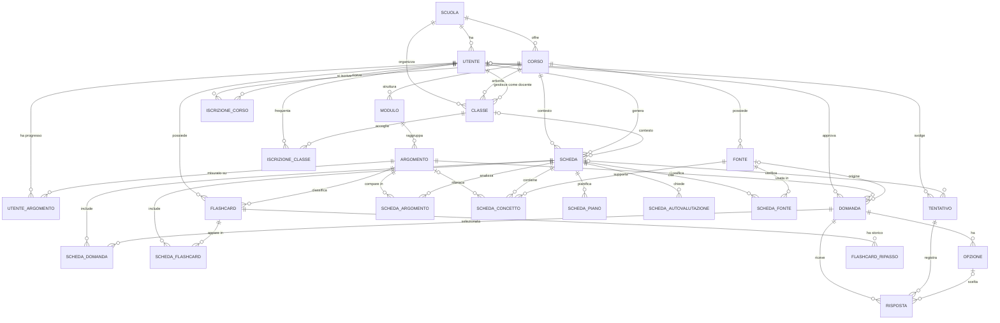
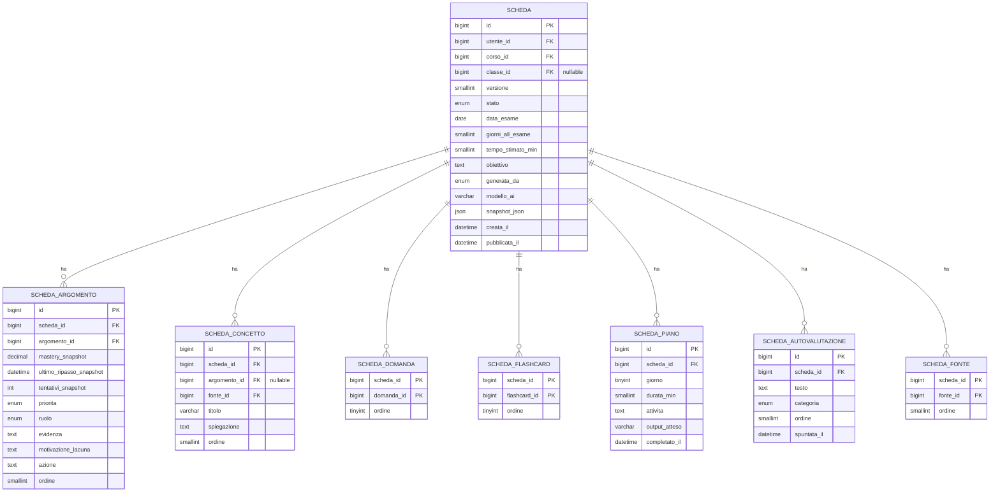

# Schema ER — gestione delle schede di ripasso

> **Perimetro:** modello dati per un'app che gestisce le schede di ripasso di uno studente iscritto al corso.
> **Fonte di analisi:** `esami/esempio-scheda-ripasso.md` (scheda di Giulia R., classe 5A).
> **Stack di riferimento:** MySQL 8 + Prisma (come da `progetto-finale.md`).
> **DDL pronto:** `docs/schema-schede.sql`.

---

## 1. Idea centrale

La scheda non è un documento monolitico: è un **aggregato versionato** composto da sezioni con struttura stabile.

Il modello separa tre livelli:

1. **Contesto multiutente** — scuola, utente, corso, classe, iscrizioni.
2. **Catalogo didattico** — moduli, argomenti, domande, opzioni, fonti.
3. **Scheda e attività** — scheda, sezioni della scheda, tentativi, risposte, flashcard e ripassi.

La scheda pubblicata è **immutabile**: per rigenerarla si crea una nuova versione. Questo rende confrontabili i progressi nel tempo e permette di rigenerare un PDF identico a quello originale.

---

## 2. Dalla scheda di esempio al modello

| Sezione della scheda | Informazioni | Entità / attributi |
|---|---|---|
| Intestazione | studente, classe, data, esame tra 14 giorni, tempo stimato | `scheda.utente_id`, `classe_id`, `creata_il`, `data_esame`, `giorni_all_esame`, `tempo_stimato_min` |
| 1. Obiettivo dell'esame | testo dell'obiettivo | `scheda.obiettivo` |
| 2. Mappa argomenti | argomento, padronanza, ultimo ripasso, priorità | `scheda_argomento` + `argomento` |
| 3. Punti di forza | 3 argomenti + evidenza | `scheda_argomento.ruolo = FORZA`, `evidenza` |
| 4. Lacune prioritarie | argomento, perché, azione | `scheda_argomento.ruolo = LACUNA`, `motivazione_lacuna`, `azione` |
| 5. Concetti chiave | titolo, spiegazione, fonte | `scheda_concetto` + `fonte` |
| 6. Quiz di verifica | 10 domande, livello, opzioni, risposta, spiegazione | `domanda`, `opzione`, `scheda_domanda`, `tentativo`, `risposta` |
| 7. Flashcard | fronte, retro, stato di ripasso | `flashcard`, `scheda_flashcard`, `flashcard_ripasso` |
| 8. Piano 7 giorni | giorno, attività, durata, output | `scheda_piano` |
| 9. Autovalutazione | item, categoria, spunta | `scheda_autovalutazione` |
| 10. Fonti | moduli, appunti, documentazione, progetto | `fonte`, `scheda_fonte` |

---

## 3. Diagramma ER



### 3.1 Dettaglio dell'aggregato `scheda`



---

## 4. Dizionario delle entità

### 4.1 Contesto multiutente

| Entità | Chiave | Attributi principali | Note |
|---|---|---|---|
| `scuola` | `id` | `nome`, `slug`, `creato_il` | Tenant radice. |
| `utente` | `id` | `scuola_id`, `email`, `password_hash`, `nome`, `ruolo`, `email_verificata`, `creato_il` | Ruoli: studente, docente, admin. |
| `corso` | `id` | `scuola_id`, `titolo`, `codice`, `descrizione`, `attivo`, `creato_il` | Il corso a cui lo studente è iscritto. |
| `iscrizione_corso` | `id` | `corso_id`, `utente_id`, `iscritto_il`, `completato_il` | N:M tra utente e corso; unique `(corso_id, utente_id)`. |
| `classe` | `id` | `scuola_id`, `corso_id`, `nome`, `codice_invito`, `docente_id` | Contesto didattico della scheda (es. 5A). |
| `iscrizione_classe` | `id` | `classe_id`, `utente_id`, `creato_il` | N:M tra utente e classe. |
| `modulo` | `id` | `corso_id`, `numero`, `titolo` | Moduli 01–10 del corso. |
| `argomento` | `id` | `modulo_id`, `nome`, `slug`, `descrizione` | HTML, CSS, React, Prisma, ecc. |
| `utente_argomento` | `(utente_id, argomento_id)` | `mastery`, `tentativi_totali`, `ultimo_ripasso_il`, `aggiornato_il` | **Stato corrente** per dashboard e algoritmo adattivo. |

### 4.2 Scheda

| Entità | Chiave | Attributi principali | Note |
|---|---|---|---|
| `scheda` | `id` | `utente_id`, `corso_id`, `classe_id`, `versione`, `stato`, `titolo`, `data_esame`, `giorni_all_esame`, `tempo_stimato_min`, `obiettivo`, `generata_da`, `modello_ai`, `snapshot_json`, `creata_il`, `pubblicata_il` | Aggregate root, versionato per utente e corso. |
| `scheda_argomento` | `id` | `scheda_id`, `argomento_id`, `mastery_snapshot`, `ultimo_ripasso_snapshot`, `tentativi_snapshot`, `priorita`, `ruolo`, `evidenza`, `motivazione_lacuna`, `azione`, `ordine` | Mappa argomenti + punti di forza + lacune. |
| `fonte` | `id` | `corso_id`, `tipo`, `titolo`, `riferimento` | Catalogo delle fonti citabili. |
| `scheda_fonte` | `(scheda_id, fonte_id)` | `ordine` | Sezione "Fonti" della scheda. |
| `scheda_concetto` | `id` | `scheda_id`, `argomento_id`, `fonte_id`, `titolo`, `spiegazione`, `ordine` | 5–7 concetti chiave, ognuno con fonte obbligatoria. |
| `scheda_piano` | `id` | `scheda_id`, `giorno`, `durata_min`, `attivita`, `output_atteso`, `completato_il` | Piano di 7 giorni. |
| `scheda_autovalutazione` | `id` | `scheda_id`, `testo`, `categoria`, `ordine`, `spuntata_il` | Checklist "so spiegare / so fare / devo rivedere". |

### 4.3 Catalogo quiz

| Entità | Chiave | Attributi principali | Note |
|---|---|---|---|
| `domanda` | `id` | `argomento_id`, `livello`, `testo`, `spiegazione`, `stato`, `origine`, `fonte_id`, `creata_da`, `approvata_da`, `approvata_il`, `creata_il` | Riutilizzabile; pubblicabile solo dopo approvazione umana. |
| `opzione` | `id` | `domanda_id`, `testo`, `corretta`, `ordine` | 4 opzioni per domanda, una sola corretta. |
| `scheda_domanda` | `(scheda_id, domanda_id)` | `ordine` | Seleziona le 10 domande della scheda. |
| `tentativo` | `id` | `utente_id`, `scheda_id`, `origine`, `stato`, `iniziato_il`, `finito_il`, `risposte_totali`, `risposte_corrette`, `punteggio` | Un tentativo può essere legato a una scheda o a un test diagnostico/adattivo. |
| `risposta` | `id` | `tentativo_id`, `domanda_id`, `opzione_id`, `corretta`, `tempo_ms`, `risposto_il` | Storico delle risposte; alimenta la mastery. |

### 4.4 Flashcard

| Entità | Chiave | Attributi principali | Note |
|---|---|---|---|
| `flashcard` | `id` | `utente_id`, `argomento_id`, `fonte_id`, `fronte`, `retro`, `facilita`, `intervallo_giorni`, `ripasso_il`, `stato`, `creata_il` | Posseduta dallo studente e riutilizzabile tra schede. |
| `scheda_flashcard` | `(scheda_id, flashcard_id)` | `ordine` | Le 10 carte incluse nella scheda. |
| `flashcard_ripasso` | `id` | `flashcard_id`, `qualita`, `intervallo_precedente`, `intervallo_nuovo`, `facilita_precedente`, `facilita_nuova`, `ripassata_il` | Storico SM-2, utile per audit e statistiche. |

---

## 5. Relazioni e cardinalità

| Relazione | Cardinalità | Regola |
|---|---|---|
| `scuola` → `utente` | 1 : N | Un utente appartiene a una scuola. |
| `utente` ↔ `corso` | N : M | Tramite `iscrizione_corso`; unique `(corso_id, utente_id)`. |
| `utente` ↔ `classe` | N : M | Tramite `iscrizione_classe`; unique `(classe_id, utente_id)`. |
| `corso` → `modulo` | 1 : N | Un modulo non esiste senza corso. |
| `modulo` → `argomento` | 1 : N | Un argomento appartiene a un modulo. |
| `utente` ↔ `argomento` | N : M | Tramite `utente_argomento`: stato corrente di padronanza. |
| `utente` → `scheda` | 1 : N | Ogni scheda appartiene a un solo studente. |
| `scheda` ↔ `argomento` | N : M | Tramite `scheda_argomento`: fotografia della padronanza. |
| `scheda` → `scheda_concetto` | 1 : N | 5–7 concetti per scheda. |
| `fonte` → `scheda_concetto` | 1 : N | Ogni concetto deve citare una fonte. |
| `scheda` ↔ `fonte` | N : M | Tramite `scheda_fonte`: elenco fonti della scheda. |
| `scheda` ↔ `domanda` | N : M | Tramite `scheda_domanda`: 10 domande per scheda. |
| `domanda` → `opzione` | 1 : N | 4 opzioni, una sola corretta. |
| `scheda` → `tentativo` | 1 : N | Opzionale: il tentativo può nascere anche fuori dalla scheda. |
| `tentativo` → `risposta` | 1 : N | Una risposta per domanda per tentativo. |
| `domanda` → `risposta` | 1 : N | Storico delle risposte alla domanda. |
| `opzione` → `risposta` | 1 : N | Nullable se la domanda è saltata. |
| `scheda` ↔ `flashcard` | N : M | Tramite `scheda_flashcard`: 10 carte per scheda. |
| `flashcard` → `flashcard_ripasso` | 1 : N | Storico dei ripassi SM-2. |
| `scheda` → `scheda_piano` | 1 : N | Esattamente 7 giorni. |
| `scheda` → `scheda_autovalutazione` | 1 : N | Checklist della scheda. |

---

## 6. Enumerazioni

| Enum | Valori | Uso |
|---|---|---|
| `ruolo_utente` | `STUDENTE`, `DOCENTE`, `ADMIN` | Autorizzazione. |
| `stato_scheda` | `BOZZA`, `GENERATA`, `PUBBLICATA`, `ARCHIVIATA` | Ciclo di vita della scheda. |
| `generata_da` | `AI`, `UMANO`, `MISTA` | Provenienza del contenuto. |
| `priorita` | `CRITICA`, `ALTA`, `MEDIA`, `BASSA` | Priorità dell'argomento. |
| `ruolo_argomento` | `STANDARD`, `FORZA`, `LACUNA` | Ruolo nella mappa argomenti. |
| `tipo_fonte` | `MODULO`, `APPUNTI`, `DOCUMENTAZIONE`, `PROGETTO`, `ALTRO` | Classificazione delle fonti. |
| `livello_domanda` | `L1`, `L2`, `L3`, `L4` | Livello Bloom della domanda. |
| `stato_domanda` | `BOZZA`, `APPROVATA`, `RIFIUTATA`, `ARCHIVIATA` | Human-in-the-loop. |
| `origine_contenuto` | `AI`, `UMANO`, `MISTA` | Provenienza di domande e schede. |
| `stato_tentativo` | `IN_CORSO`, `COMPLETATO`, `ABBANDONATO` | Ciclo di vita del tentativo. |
| `origine_tentativo` | `SCHEDA`, `DIAGNOSTICO`, `ADATTIVO`, `ASSEGNAZIONE` | Contesto del tentativo. |
| `stato_flashcard` | `ATTIVA`, `SOSPESA`, `ARCHIVIATA` | Disponibilità della carta. |
| `categoria_autovalutazione` | `SAPER_SPIEGARE`, `SAPER_FARE`, `DA_RIVEDERE` | Tipo di checklist. |

> Se in futuro gli admin devono modificare priorità, livelli o tipi di fonte, questi enum possono diventare tabelle di lookup. Per ora sono insiemi piccoli e stabili: l'enum evita join inutili.

---

## 7. Vincoli di integrità

### 7.1 Vincoli strutturali (database)

- `scheda` unique `(utente_id, corso_id, versione)`.
- `scheda_argomento` unique `(scheda_id, argomento_id)` e `(scheda_id, ordine)`.
- `scheda_concetto` unique `(scheda_id, ordine)`; `ordine` tra 1 e 7.
- `scheda_domanda` unique `(scheda_id, domanda_id)` e `(scheda_id, ordine)`; `ordine` tra 1 e 10.
- `scheda_flashcard` unique `(scheda_id, flashcard_id)` e `(scheda_id, ordine)`; `ordine` tra 1 e 10.
- `scheda_piano` unique `(scheda_id, giorno)`; `giorno` tra 1 e 7.
- `scheda_autovalutazione` unique `(scheda_id, ordine)`.
- `opzione` unique `(domanda_id, ordine)`; `ordine` tra 1 e 4.
- `risposta` unique `(tentativo_id, domanda_id)`.
- `flashcard.facilita` tra 1.30 e 2.80; `intervallo_giorni >= 1`.
- `utente_argomento.mastery` e `scheda_argomento.mastery_snapshot` tra 0 e 1.
- `scheda.giorni_all_esame >= 0`.
- Una domanda `APPROVATA` deve avere `approvata_da` e `approvata_il`.
- Una scheda `PUBBLICATA` deve avere `pubblicata_il`.

### 7.2 Vincoli di dominio (service layer / transazione)

Alcuni vincoli coinvolgono più righe e non sono esprimibili con un semplice `CHECK`:

- Una scheda pubblicata deve avere **5–7 concetti**, **10 domande**, **10 flashcard**, **7 giorni di piano**, almeno **1 fonte**.
- Le 10 domande devono rispettare la distribuzione **4 L1–L2, 4 L3, 2 L4**.
- Ogni domanda deve avere **4 opzioni** e **una sola** `corretta`.
- Massimo **3** argomenti con `ruolo = FORZA` e massimo **3** con `ruolo = LACUNA`.
- Ogni concetto deve avere una fonte; nessun contenuto senza fonte.
- Le sezioni di una scheda pubblicata non si modificano: si crea una nuova versione.
- La lettura di una scheda passa sempre dal filtro di ownership: `scheda.utente_id = utente_corrente`, salvo docente della classe o admin della scuola.

La validazione va eseguita in una **transazione** prima di impostare `stato = PUBBLICATA`; se un conteggio non torna, la scheda resta `BOZZA` e il job fallisce con un errore esplicito.

---

## 8. Indici consigliati

| Tabella | Indice | Perché |
|---|---|---|
| `scheda` | `(utente_id, creata_il DESC)` | Ultime schede dello studente. |
| `scheda` | `(utente_id, stato)` | Bozze/pubblicate per utente. |
| `scheda` | `(corso_id, stato)` | Report di corso/classe. |
| `scheda_argomento` | `(scheda_id, ordine)` | Rendering ordinato. |
| `scheda_argomento` | `(argomento_id)` | Statistiche per argomento. |
| `scheda_domanda` | `(scheda_id, ordine)` | Quiz della scheda. |
| `scheda_flashcard` | `(scheda_id, ordine)` | Carte della scheda. |
| `domanda` | `(argomento_id, livello, stato)` | Selezione adattiva. |
| `opzione` | `(domanda_id, ordine)` | Caricamento opzioni. |
| `tentativo` | `(utente_id, iniziato_il DESC)` | Storico tentativi. |
| `tentativo` | `(scheda_id)` | Tentativi di una scheda. |
| `risposta` | `(tentativo_id, domanda_id)` | Recupero risposte. |
| `risposta` | `(domanda_id)` | Statistiche per domanda. |
| `flashcard` | `(utente_id, ripasso_il)` | Carte scadute oggi. |
| `flashcard` | `(argomento_id)` | Carte per argomento. |
| `flashcard_ripasso` | `(flashcard_id, ripassata_il DESC)` | Storico SM-2. |
| `utente_argomento` | `(argomento_id)` | Classifiche e report. |

---

## 9. Decisioni di modellazione

### 9.1 Scheda come snapshot versionato

La scheda viene generata in un momento preciso e deve restare leggibile anche se nel frattempo cambiano domande, flashcard o padronanza.

- `scheda` contiene i dati di intestazione e il `snapshot_json` completo.
- Le tabelle figlie contengono i riferimenti normalizzati alle entità usate.
- Una rigenerazione crea una nuova `scheda` con `versione` incrementata.
- Una scheda `PUBBLICATA` non viene aggiornata: eventuali modifiche manuali producono una nuova versione.

**Alternativa scartata:** una sola tabella `schede` con tutto il contenuto in JSON (come il `contenuto Json` del progetto finale). È semplice, ma non permette query efficienti su padronanza, lacune, argomenti e storico; inoltre non offre vincoli di integrità.

### 9.2 Doppia memoria della padronanza

- `utente_argomento.mastery` = valore **corrente**, aggiornato dopo ogni tentativo.
- `scheda_argomento.mastery_snapshot` = valore **al momento della generazione**.

**Perché:** la dashboard legge un valore già pronto, senza ricalcolare tutti i tentativi; la scheda storica mostra esattamente i numeri visti dallo studente quel giorno. È anche la base per un grafico "mastery nel tempo".

### 9.3 Catalogo riutilizzabile + tabelle ponte

Domande e flashcard non vengono copiate dentro la scheda: si riusano tramite `scheda_domanda` e `scheda_flashcard`. Questo evita duplicati e permette di misurare la qualità di una domanda su tutti gli studenti.

Per garantire che una scheda pubblicata non cambi se una domanda viene modificata, si combinano:

- domande approvate considerate **immutabili** (o versionate in `domanda_versione`, estensione futura);
- `snapshot_json` della scheda per il rendering PDF;
- `risposta.corretta` salvata al momento della risposta.

### 9.4 Fonti obbligatorie

`fonte` è un catalogo (modulo, appunti, documentazione, progetto). `scheda_concetto.fonte_id` è `NOT NULL`: la regola "nessun contenuto senza fonte" diventa un vincolo del database, non solo una linea guida editoriale.

### 9.5 JSON solo per presentazione e audit

`snapshot_json` non sostituisce le tabelle: conserva il payload esatto per PDF, debug e confronto. Le query di prodotto usano sempre le colonne normalizzate.

### 9.6 Cancellazione e GDPR

- Schede, concetti, piani, checklist e flashcard dello studente: `ON DELETE CASCADE`.
- Tentativi e risposte: non vengono cancellati fisicamente; `tentativo.utente_id` e `tentativo.scheda_id` diventano `NULL` per conservare statistiche aggregate anonime.
- Retention consigliata: tentativi 24 mesi, job AI 30 giorni, log 90 giorni.
- In Supabase/Postgres, aggiungere RLS policies equivalenti al filtro di ownership applicato da Express.

### 9.7 ID

- MySQL: `BIGINT UNSIGNED AUTO_INCREMENT`.
- Se si passa a Supabase/Postgres: `UUID DEFAULT gen_random_uuid()` per gli identificativi esposti nelle URL, così non si enumerano le schede altrui.

---

## 10. Flusso di generazione di una scheda

```text
1. Lo studente richiede una nuova scheda per il corso.
2. Il servizio legge:
   - utente_argomento (mastery corrente, ultimo ripasso)
   - tentativi/risposte recenti
   - argomenti del corso
3. Crea scheda in stato BOZZA con versione successiva.
4. Inserisce scheda_argomento per tutti gli argomenti:
   - calcola priorità
   - marca fino a 3 FORZA e 3 LACUNA con evidenza/motivazione/azione
5. Seleziona 5–7 concetti e li collega alle fonti.
6. Seleziona 10 domande approvate (4 L1–L2, 4 L3, 2 L4).
7. Seleziona o crea 10 flashcard e le collega alla scheda.
8. Inserisce 7 righe in scheda_piano e la checklist di autovalutazione.
9. Valida i conteggi e i vincoli di dominio.
10. Salva snapshot_json, imposta stato PUBBLICATA e pubblicata_il.
11. Commit.
```

Se la generazione è asincrona (LangChain), i passi 4–10 sono eseguiti dal worker e la scheda resta `BOZZA` finché il job non termina. Un errore lascia la scheda in `BOZZA` e registra il motivo in un `ai_job` (estensione).

---

## 11. Query che il modello deve rendere semplici

```sql
-- Ultima scheda pubblicata di uno studente
SELECT *
FROM scheda
WHERE utente_id = ?
  AND stato = 'PUBBLICATA'
ORDER BY creata_il DESC
LIMIT 1;

-- Argomenti mai ripassati
SELECT a.nome
FROM argomento a
JOIN utente_argomento ua ON ua.argomento_id = a.id
WHERE ua.utente_id = ?
  AND ua.ultimo_ripasso_il IS NULL;

-- Flashcard scadute oggi
SELECT *
FROM flashcard
WHERE utente_id = ?
  AND stato = 'ATTIVA'
  AND ripasso_il <= CURRENT_DATE
ORDER BY ripasso_il;

-- Lacune della scheda con azione
SELECT a.nome, sa.motivazione_lacuna, sa.azione
FROM scheda_argomento sa
JOIN argomento a ON a.id = sa.argomento_id
WHERE sa.scheda_id = ?
  AND sa.ruolo = 'LACUNA'
ORDER BY sa.ordine;

-- Andamento della padronanza per argomento
SELECT s.creata_il, sa.mastery_snapshot
FROM scheda s
JOIN scheda_argomento sa ON sa.scheda_id = s.id
WHERE s.utente_id = ?
  AND sa.argomento_id = ?
  AND s.stato = 'PUBBLICATA'
ORDER BY s.creata_il;
```

---

## 12. Estensioni previste

| Estensione | Scopo |
|---|---|
| `assegnazione` | Il docente assegna una scheda o un quiz a una classe con scadenza. |
| `ai_job` | Tracciare generazione, costo, stato e modello usato. |
| `audit_log` | Chi ha approvato/modificato/cancellato cosa. |
| `domanda_versione` | Versionare una domanda senza rompere le schede storiche. |
| `scheda_export` | Storico dei PDF generati e relativo hash. |
| `notifica` | Quiz assegnati, scadenze, ripassi del giorno. |
| `refresh_token`, `password_reset` | Autenticazione completa. |

---

## 13. Esempio di popolazione (scheda di Giulia)

- `utente` = Giulia R., `classe` = 5A, `corso` = AI Web Development.
- `scheda` = versione 1, `data_esame` 2026-11-26, `giorni_all_esame` 14, `tempo_stimato_min` 25, stato `PUBBLICATA`.
- `scheda_argomento` = 10 righe: HTML 0.85 (FORZA), JavaScript 0.70 (FORZA), MySQL 0.65 (FORZA), React 0.55 (LACUNA), Node.js 0.50 (LACUNA), Express 0.45 (LACUNA), Prisma 0.40, LangChain 0.35, CSS 0.60, Skill/Agenti 0.30 (CRITICA).
- `scheda_concetto` = 7 righe, ciascuna con `fonte_id`.
- `scheda_domanda` = 10 righe ordinate.
- `scheda_flashcard` = 10 righe ordinate.
- `scheda_piano` = 7 righe, giorni 1–7.
- `scheda_autovalutazione` = 6 righe, 2 spuntate e 4 da rivedere.

Questo rende la scheda interrogabile: "quali lacune avevo il 12 novembre?", "quante volte ho ripassato Prisma?", "quali flashcard sono scadute oggi?".
