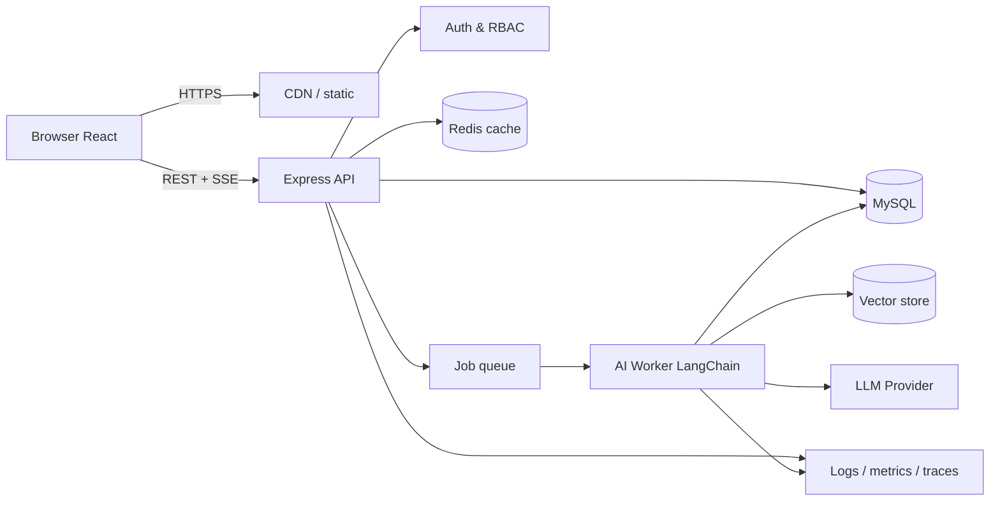
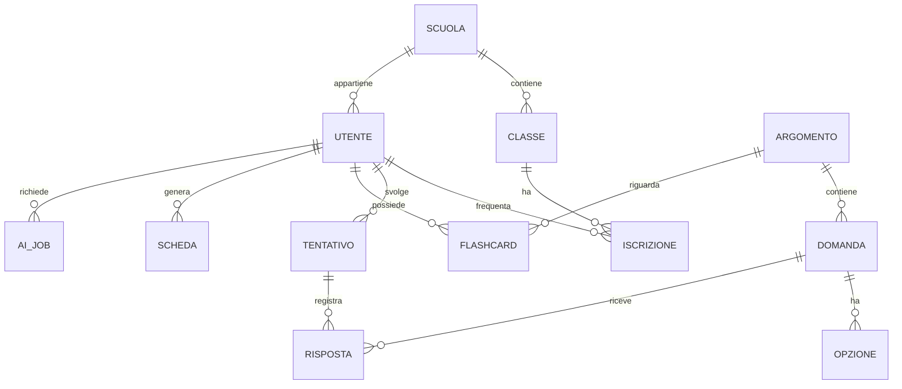

# Progetto finale — RipassoAI

> **Piattaforma multiutente per il ripasso adattivo e la preparazione all'esame finale.**
> Durata: 3 settimane (settimane 10–12; il modulo 10 procede in parallelo nella prima settimana) · Lavoro in team da 3 · Consegna: demo + repository + documentazione.

---

## 1. Obiettivo

Costruire una web app che permetta a **molti studenti** di ripassare gli argomenti del corso, misurare i progressi e arrivare preparati all'esame, con l'aiuto di quiz adattivi e di un tutor AI fondato sui materiali del corso.

### Vincoli didattici

- Stack obbligatorio: React + Express + MySQL + Prisma + LangChain.
- AI usata in modo **verificabile**: ogni domanda generata ha una fonte e un'approvazione umana.
- Multiutenza reale: studenti, docenti, admin, più classi e più scuole.
- Accessibilità AA, responsive, sicurezza by default.
- Nessun dato personale inutile, nessun segreto nel repository.

---

## 2. Persone e bisogni

| Persona | Bisogno | Cosa fa nella piattaforma |
|---|---|---|
| **Studente** | Capire cosa sa e cosa no, ripassare in poco tempo | Test diagnostico, quiz adattivi, scheda di ripasso, flashcard, tutor AI |
| **Docente** | Preparare la classe, vedere chi è indietro | Crea classi, assegna quiz, approva domande AI, legge statistiche |
| **Admin** | Gestire l'istituto e i costi | Utenti, ruoli, scuole, cataloghi, budget AI, audit |
| **Tutor AI** | Rispondere con fonti affidabili | RAG sugli appunti, tool sui progressi, citazioni |

---

## 3. Funzionalità

### 3.1 Studente

- Registrazione con email, verifica, login, recupero password.
- Codice classe per iscriversi.
- Test diagnostico iniziale (20 domande, 4 livelli).
- Quiz adattivi per argomento con feedback e spiegazione.
- **Scheda di ripasso personalizzata**: punti di forza, lacune, concetti chiave, 10 domande, 10 flashcard, piano di 7 giorni.
- Flashcard con ripetizione spaziata.
- Dashboard: padronanza per argomento, streak, tempo di studio, ultimi tentativi.
- Tutor AI con citazioni e rifiuto quando non sa.
- Export PDF della scheda.

### 3.2 Docente

- Creazione classi e codici invito.
- Assegnazione quiz con scadenza e livello.
- Statistiche per classe, studente, argomento, livello.
- Coda di revisione delle domande generate dall'AI (approva/modifica/rifiuta).
- Generazione quiz da appunti con anteprima.
- Export CSV dei risultati.

### 3.3 Admin

- Gestione utenti e ruoli.
- Gestione scuole e classi.
- Catalogo argomenti e domande.
- Monitoraggio costi AI, rate limit, job falliti.
- Audit log delle azioni sensibili.
- Backup e stato del sistema.

---

## 4. Flussi principali

### Flusso studente

```text
Registrazione → verifica email → inserisci codice classe
→ test diagnostico → dashboard con lacune
→ scheda di ripasso → quiz adattivo → feedback
→ flashcard del giorno → tutor per un dubbio → nuovo test
```

### Flusso docente

```text
Login → crea classe → invita studenti
→ carica appunti → genera quiz AI → revisiona → assegna
→ monitora progressi → esporta report
```

### Flusso AI (generazione)

```text
Appunti → chunk + embedding → vector store
→ generator → schema validation → critic → validator
→ stato "bozza" → revisione docente → "pubblicata"
```

---

## 5. Architettura



### Scelte architetturali

| Decisione | Motivazione | Alternativa scartata |
|---|---|---|
| React SPA + API REST | Team piccolo, deploy semplice, ecosistema noto | SSR completo (più complesso) |
| MySQL + Prisma | Stack del corso, relazioni chiare, migrazioni | NoSQL (meno adatto ai report) |
| Vector store esterno | MySQL non è un vector DB maturo | pgvector (richiederebbe PostgreSQL) |
| Job queue per AI | Le generazioni sono lente e costose | Chiamata sincrona (blocca e va in timeout) |
| JWT in cookie httpOnly | Protezione da XSS sul token | localStorage (esposto a XSS) |
| Redis per cache/rate limit | Stateless e veloce | Memoria del processo (non scala) |

> Scrivete queste decisioni in `docs/ADR.md`, con data, contesto, conseguenze.

---

## 6. Modello dati

### Entità principali



### Schema Prisma (estratto)

```prisma
// Estratto: i modelli Tentativo, Argomento, Domanda, Opzione e Risposta
// sono definiti nel Modulo 08 e vanno inclusi nello schema completo.

model Scuola {
  id       BigInt   @id @default(autoincrement())
  nome     String   @db.VarChar(150)
  slug     String   @unique @db.VarChar(80)
  utenti   Utente[]
  classi   Classe[]
  creatoIl DateTime @default(now()) @map("creato_il")
  @@map("scuole")
}

model Utente {
  id           BigInt    @id @default(autoincrement())
  scuolaId     BigInt    @map("scuola_id")
  scuola       Scuola    @relation(fields: [scuolaId], references: [id])
  email        String    @unique @db.VarChar(255)
  passwordHash String    @map("password_hash")
  nome         String    @db.VarChar(100)
  ruolo        Ruolo     @default(STUDENTE)
  emailVerificata Boolean @default(false) @map("email_verificata")
  creatoIl     DateTime  @default(now()) @map("creato_il")
  iscrizioni   Iscrizione[]
  tentativi    Tentativo[]
  flashcard    Flashcard[]
  schede       Scheda[]
  aiJobs       AiJob[]
  classiDocente Classe[] @relation("DocenteClassi")
  @@index([scuolaId, ruolo])
  @@map("utenti")
}

model Classe {
  id        BigInt      @id @default(autoincrement())
  scuolaId  BigInt      @map("scuola_id")
  scuola    Scuola      @relation(fields: [scuolaId], references: [id])
  nome      String      @db.VarChar(100)
  codice    String      @unique @db.VarChar(12)
  docenteId BigInt      @map("docente_id")
  docente   Utente      @relation("DocenteClassi", fields: [docenteId], references: [id])
  iscrizioni Iscrizione[]
  creatoIl  DateTime    @default(now()) @map("creato_il")
  @@index([scuolaId, docenteId])
  @@map("classi")
}

model Iscrizione {
  id        BigInt   @id @default(autoincrement())
  classeId  BigInt   @map("classe_id")
  classe    Classe   @relation(fields: [classeId], references: [id], onDelete: Cascade)
  utenteId  BigInt   @map("utente_id")
  utente    Utente   @relation(fields: [utenteId], references: [id], onDelete: Cascade)
  creatoIl  DateTime @default(now()) @map("creato_il")
  @@unique([classeId, utenteId])
  @@map("iscrizioni")
}

model Scheda {
  id        BigInt   @id @default(autoincrement())
  utenteId  BigInt   @map("utente_id")
  utente    Utente   @relation(fields: [utenteId], references: [id], onDelete: Cascade)
  contenuto Json
  creatoIl  DateTime @default(now()) @map("creato_il")
  @@index([utenteId, creatoIl])
  @@map("schede")
}

model Flashcard {
  id          BigInt   @id @default(autoincrement())
  utenteId    BigInt   @map("utente_id")
  utente      Utente   @relation(fields: [utenteId], references: [id], onDelete: Cascade)
  argomentoId BigInt   @map("argomento_id")
  fronte      String   @db.Text
  retro       String   @db.Text
  facilita    Float    @default(2.5)
  intervallo  Int      @default(1)
  ripassoIl   DateTime @map("ripasso_il")
  @@index([utenteId, ripassoIl])
  @@map("flashcard")
}

model AiJob {
  id        BigInt   @id @default(autoincrement())
  utenteId  BigInt   @map("utente_id")
  utente    Utente   @relation(fields: [utenteId], references: [id], onDelete: Cascade)
  tipo      String   @db.VarChar(50)
  stato     JobStato @default(QUEUED)
  input     Json
  output    Json?
  errore    String?  @db.Text
  costoUsd  Decimal  @default(0) @db.Decimal(8, 4)
  creatoIl  DateTime @default(now()) @map("creato_il")
  finitoIl  DateTime? @map("finito_il")
  @@index([stato, creatoIl])
  @@map("ai_jobs")
}

enum Ruolo { STUDENTE DOCENTE ADMIN }
enum JobStato { QUEUED RUNNING DONE FAILED }
```

> Aggiungete `Assegnazione`, `AuditLog`, `RefreshToken`, `PasswordReset` in base alle esigenze.

---

## 7. API REST

| Area | Metodo e path | Ruolo | Note |
|---|---|---|---|
| Auth | `POST /api/auth/register` | pubblico | Rate limit, verifica email |
| Auth | `POST /api/auth/login` | pubblico | Cookie httpOnly |
| Auth | `POST /api/auth/logout` | auth | Revoca sessione |
| Auth | `GET /api/auth/me` | auth | Profilo e ruoli |
| Classi | `POST /api/classi` | docente | Genera codice invito |
| Classi | `POST /api/classi/join` | studente | Codice + iscrizione |
| Argomenti | `GET /api/argomenti` | auth | Conteggi domande |
| Quiz | `POST /api/tentativi` | studente | Avvia, restituisce domande senza soluzione |
| Quiz | `POST /api/tentativi/:id/risposte` | studente | Salva una risposta |
| Quiz | `POST /api/tentativi/:id/submit` | studente | Idempotente, calcola punteggio |
| Progressi | `GET /api/progressi/me` | studente | Padronanza per argomento |
| Progressi | `GET /api/classi/:id/progressi` | docente | Solo classi proprie |
| Scheda | `POST /api/schede` | studente | Genera scheda (job AI) |
| Scheda | `GET /api/schede/:id` | proprietario | JSON/PDF |
| Flashcard | `GET /api/flashcard/due` | studente | Scadute oggi |
| Flashcard | `POST /api/flashcard/:id/review` | studente | Aggiorna SM-2 |
| AI | `POST /api/ai/genera-quiz` | docente | Job asincrono |
| AI | `GET /api/ai/jobs/:id` | proprietario | Stato e risultato |
| AI | `POST /api/ai/tutor` | studente | SSE streaming, citazioni |
| Admin | `GET /api/admin/utenti` | admin | Paginato |
| Admin | `PATCH /api/admin/utenti/:id/ruolo` | admin | Audit log |

**Convenzioni:** errori `{ error, details? }`; paginazione `{ items, page, pageSize, total, pages }`; date ISO 8601; ID come stringhe; nessun dato sensibile nelle risposte.

---

## 8. Algoritmo adattivo

### Padronanza per argomento

Per ogni risposta:

```text
peso = livello (1–4)
contributo = corretta ? peso : 0
mastery = somma(contributo) / somma(peso)
```

Correzione per recenza:

```text
mastery_recente = mastery * 0.7 + mastery_ultimi_5 * 0.3
```

### Scelta della prossima domanda

1. Se `mastery < 0.4` → livello 1–2.
2. Se `0.4 ≤ mastery < 0.7` → livello 2–3.
3. Se `mastery ≥ 0.7` → livello 3–4.
4. Escludi domande già viste nelle ultime 3 sessioni.
5. Preferisci argomenti con `mastery` più bassa e non ripassati da ≥ 7 giorni.
6. Se non ci sono domande adatte, allarga il livello e segnala il gap al docente.

### Stop

- 10 domande oppure 8 minuti;
- almeno 4 livelli toccati;
- risultato sempre spiegato, mai solo punteggio.

### Ripetizione spaziata (SM-2 semplificato)

```text
Se risposta corretta:
  intervallo = intervallo === 1 ? 3 : round(intervallo * facilita)
  facilita = min(2.8, facilita + 0.1)
Altrimenti:
  intervallo = 1
  facilita = max(1.3, facilita - 0.2)
ripassoIl = oggi + intervallo giorni
```

---

## 9. Scheda di ripasso

Contenuto generato (con AI + dati reali):

1. **Intestazione:** studente, classe, data, tempo stimato.
2. **Mappa argomenti:** verde/giallo/rosso con mastery e numero tentativi.
3. **Punti di forza:** 3 argomenti con evidenza dai dati.
4. **Lacune prioritarie:** 3 argomenti con il maggiore impatto atteso.
5. **Concetti chiave:** 5–7 definizioni brevi, ciascuna con fonte.
6. **Quiz di verifica:** 10 domande (4 L1–L2, 4 L3, 2 L4) con soluzioni in fondo.
7. **Flashcard:** 10 carte.
8. **Piano 7 giorni:** 20–30 minuti al giorno, alternando lettura, quiz e flashcard.
9. **Autovalutazione:** checklist "so spiegare / so fare / devo rivedere".
10. **Fonti:** elenco documenti usati.

Regole: nessun contenuto senza fonte; le domande AI devono essere approvate; il PDF deve essere accessibile e stampabile.

---

## 10. Sicurezza e privacy

### Autenticazione

- Password: `bcrypt` (cost ≥ 12) o `argon2`.
- Verifica email con token monouso a scadenza.
- Reset password con token monouso, invalidazione sessioni.
- Cookie `httpOnly`, `secure`, `sameSite=lax`; CSRF token per operazioni sensibili se necessario.
- JWT breve (2 h) + refresh token ruotato e revocabile.
- Rate limit su login, registrazione, reset, AI.

### Autorizzazione

- RBAC: `STUDENTE`, `DOCENTE`, `ADMIN`.
- Controllo per risorsa: lo studente vede solo i propri dati; il docente solo le proprie classi; l'admin per scuola.
- Ogni query include il filtro tenant/ownership; test cross-tenant obbligatori.

### Dati e GDPR

- Minimizzazione: niente data di nascita se non serve.
- Retention: tentativi 24 mesi, log 90 giorni, job AI 30 giorni (configurabile).
- Diritto di accesso, rettifica, cancellazione: endpoint e procedura documentata.
- Anonimizzazione dei tentativi alla cancellazione dell'account.
- DPA con il fornitore LLM; nessun dato personale nei prompt se non necessario.
- Log con PII redatte.

### AI

- Prompt injection: delimitatori, validazione output, tool in whitelist.
- Nessun tool distruttivo senza conferma umana.
- Budget token per utente/giorno e kill switch.
- Citazioni obbligatorie; rifiuto esplicito se manca contesto.
- Isolamento tenant nel vector store (metadati + filtro query).

### Web

- Helmet, CORS ristretto, body limit, HTTPS.
- Validazione Zod su ogni input.
- Query parametrizzate/Prisma; niente SQL concatenato.
- CSP, `X-Content-Type-Options`, `Referrer-Policy`.
- Dipendenze aggiornate e `npm audit` in CI.

---

## 11. Scalabilità per molti utenti

### Obiettivi

| Metrica | Target |
|---|---|
| Utenti concorrenti | 500 |
| Latenza API p95 | < 300 ms |
| Latenza prima risposta AI | < 2 s |
| Disponibilità | 99.5% |
| Error rate | < 1% |

### Interventi

1. **API stateless** + più istanze dietro load balancer.
2. **Connection pool** MySQL dimensionato; `connection_limit` Prisma per istanza.
3. **Redis** per sessioni/rate limit/cache dei cataloghi.
4. **Indici** su `(utente_id, iniziato_il)`, `(argomento_id, livello, attiva)`, `(stato, creato_il)`.
5. **Paginazione** obbligatoria; vietato restituire interi cataloghi.
6. **Query mirate** con `select`; niente N+1.
7. **Job queue** per generazione AI, export, email.
8. **CDN** per asset e PDF statici.
9. **Read replica** per report pesanti (se necessario).
10. **Partizionamento/archivio** dei tentativi oltre 24 mesi.
11. **Cache** dei risultati AI identici (chiave: argomento, livello, versione, modello).
12. **Load test** con k6 prima del rilascio.

### Costi AI

- Modello piccolo per generazione, modello migliore per revisione.
- Limite giornaliero per studente e per scuola.
- Cache e batch.
- Alert all'80% del budget mensile.
- Misura costo per quiz e per sessione tutor.

---

## 12. Gestione operativa di molti utenti

### Onboarding

1. L'admin crea la scuola e invita i docenti.
2. Il docente crea la classe e condivide un codice di 8 caratteri.
3. Lo studente si registra, verifica l'email, inserisce il codice.
4. Test diagnostico guidato (10–15 minuti) e prima scheda di ripasso.
5. Il docente vede subito chi non ha completato l'onboarding.

**Metriche di attivazione:** % studenti che completano il test entro 48 h, % classi con almeno un quiz assegnato, tempo medio al primo quiz.

### Ruoli e permessi

| Azione | Studente | Docente | Admin |
|---|---|---|---|
| Vedere i propri dati | ✅ | ✅ | ✅ |
| Vedere dati della classe | ❌ | ✅ | ✅ |
| Creare classi | ❌ | ✅ | ✅ |
| Modificare ruoli | ❌ | ❌ | ✅ |
| Approvare domande AI | ❌ | ✅ | ✅ |
| Vedere costi AI della scuola | ❌ | ❌ | ✅ |

### Quote e piani

| Piano | Studenti | AI/giorno per studente | Funzioni |
|---|---|---|---|
| Free | 30 | 5 richieste | Quiz, scheda base |
| Classe | 100 | 20 richieste | Tutor, export, statistiche |
| Istituto | 2.000 | 30 richieste | Multi-classe, SSO, audit, priorità |

Le quote si applicano **lato server** e sono visibili nella dashboard admin. A 80% del budget scatta un avviso; a 100% si degrada con grazia (scheda deterministica, nessun blocco totale).

### Comunicazione e supporto

- Email transazionali: verifica, reset, invito, riepilogo settimanale.
- Notifiche in-app per quiz assegnati e scadenze.
- Preferenze e opt-out chiari.
- FAQ + primo livello di supporto al docente; ticket per admin.
- Canale di segnalazione contenuti errati o inappropriati.

### Moderazione e qualità

- Coda di revisione per domande AI e segnalazioni.
- Motivi standard: errata, ambigua, duplicata, fuori programma, inappropriata.
- SLA: 48 h per contenuti segnalati, 7 giorni per revisione ordinaria.
- Ogni decisione è tracciata (chi, cosa, quando, perché).

### Analytics di prodotto (aggregati e anonimi)

- Attivazione, retention a 7/30 giorni, sessioni per studente.
- Guadagno di padronanza per argomento.
- Tasso di completamento dei quiz assegnati.
- Uso del tutor e tasso di risposta "non ho informazioni".
- Adozione docente: classi attive, quiz creati, revisioni completate.

### Rollout graduale

| Fase | Durata | Obiettivo | Criterio di passaggio |
|---|---|---|---|
| Pilota | 2 settimane | 1 classe, 25 studenti | 80% attivazione, 0 incidenti gravi |
| Estensione | 4 settimane | 5 classi, 150 studenti | p95 < 300 ms, supporto sotto controllo |
| Istituto | 1 trimestre | 1.000 studenti | Costi AI sotto budget, retention > 40% |
| Multi-istituto | successivo | 5.000 studenti | Test di carico e isolamento tenant superati |

> Non scalate le feature prima di aver stabilizzato onboarding, supporto e qualità dei contenuti.

---

## 13. Testing

| Tipo | Strumento | Cosa copre |
|---|---|---|
| Unit | Vitest | Scoring, SM-2, validazione, utility |
| Component | Testing Library | Form, QuizCard, dashboard |
| API integration | Supertest + DB test | Auth, permessi, CRUD, errori |
| E2E | Playwright | Flusso studente e docente |
| Accessibilità | axe | Pagine principali |
| Load | k6 / autocannon | 500 utenti, endpoint quiz |
| Sicurezza | OWASP ZAP / checklist | Auth, injection, rate limit |
| AI eval | script dedicato | Fedeltà, formato, citazioni, rifiuto |

**Definition of Done per una feature:**

- [ ] Requisiti e criteri di accettazione scritti.
- [ ] Test automatici (unit/integration/e2e dove serve).
- [ ] Validazione input lato server.
- [ ] Permessi verificati.
- [ ] Accessibilità base verificata.
- [ ] Log e metriche presenti.
- [ ] Documentazione aggiornata.
- [ ] Review di un compagno.

---

## 14. Osservabilità e operazioni

- **Log strutturati** con request id, utente (pseudonimizzato), route, status, durata.
- **Metriche:** richieste, errori, p95, job in coda, token AI, costo.
- **Tracing:** una richiesta AI deve essere ricostruibile (prompt, modello, tool, output).
- **Alert:** error rate > 2%, coda > 100 job, costo > budget, DB connessioni > 80%.
- **Runbook:** deploy, rollback, migrazione fallita, DB down, provider LLM down.
- **Backup:** full giornaliero + binlog; test di ripristino trimestrale.

---

## 15. Piano di lavoro (3 settimane)

### Settimana 10 — Fondamenta

| Giorno | Attività | Deliverable |
|---|---|---|
| 1 | Kickoff, requisiti, personas, wireframe | `docs/requisiti.md` |
| 2 | Schema DB, migrazioni, seed | `schema.prisma`, seed |
| 3 | Auth + RBAC + test | API auth |
| 4 | API catalogo/quiz/tentativi | API core |
| 5 | Setup client, layout, routing | Shell React |

### Settimana 11 — Prodotto

| Giorno | Attività | Deliverable |
|---|---|---|
| 6 | Dashboard studente + quiz UI | Flusso quiz completo |
| 7 | Algoritmo adattivo + SM-2 | Logica + test |
| 8 | Scheda di ripasso (dati reali) | Generazione scheda |
| 9 | Ingestion + generazione AI + revisione | Pipeline AI |
| 10 | Tutor AI + streaming + citazioni | Endpoint SSE |

### Settimana 12 — Qualità e consegna

| Giorno | Attività | Deliverable |
|---|---|---|
| 11 | Test e2e, accessibilità, bug fix | Suite verde |
| 12 | Load test, ottimizzazioni, sicurezza | Report performance |
| 13 | Deploy staging, smoke test | URL demo |
| 14 | Documentazione, demo, esame | README, ADR, presentazione |

---

## 16. Criteri di accettazione (100 punti)

### Funzionalità (40)

- [ ] Registrazione, login, logout, recupero password (5)
- [ ] Classi, codici invito, iscrizioni (5)
- [ ] Test diagnostico e quiz adattivo con livelli (8)
- [ ] Scheda di ripasso generata e scaricabile (6)
- [ ] Flashcard con ripetizione spaziata (4)
- [ ] Dashboard studente con statistiche corrette (5)
- [ ] Dashboard docente con filtri e export (4)
- [ ] Tutor AI con citazioni e rifiuto (3)

### Qualità tecnica (25)

- [ ] Architettura chiara e ADR (5)
- [ ] Test unit/integration/e2e (6)
- [ ] Accessibilità AA sulle pagine principali (5)
- [ ] Performance: p95 < 300 ms, nessun N+1 (5)
- [ ] Codice leggibile, lint pulito, nessun segreto (4)

### Sicurezza e privacy (15)

- [ ] Hash password, cookie sicuri, sessioni (4)
- [ ] RBAC e isolamento tenant testati (5)
- [ ] Validazione input e rate limit (3)
- [ ] GDPR: retention, export, cancellazione (3)

### AI (10)

- [ ] Pipeline con schema, validazione e citazioni (3)
- [ ] Human-in-the-loop (2)
- [ ] Eval set e metriche (3)
- [ ] Guardrail, budget, red team (2)

### Demo e documentazione (10)

- [ ] Demo di 10 minuti senza intoppi (4)
- [ ] README con setup e architettura (3)
- [ ] Spiegazione delle decisioni e dei compromessi (3)

---

## 17. Demo finale (10 minuti)

1. **Minuto 0–1:** problema e personas.
2. **Minuto 1–3:** studente si registra, entra in classe, fa il test diagnostico.
3. **Minuto 3–5:** scheda di ripasso personalizzata + quiz adattivo.
4. **Minuto 5–7:** docente genera quiz dagli appunti, rivede, assegna, vede statistiche.
5. **Minuto 7–9:** tutor AI risponde con citazioni e rifiuta una domanda fuori contesto.
6. **Minuto 9–10:** architettura, test, costi, lezioni apprese.

**Regola:** niente slide al posto del prodotto; ogni numero mostrato deve essere reale.

---

## 18. Rischi e mitigazioni

| Rischio | Impatto | Mitigazione |
|---|---|---|
| AI genera domande sbagliate | Alto | Validazione + revisione umana + eval |
| Costi AI fuori controllo | Alto | Budget, cache, modelli piccoli, rate limit |
| Dati tra scuole diversi | Critico | Filtro tenant obbligatorio + test |
| Database lento con molti tentativi | Alto | Indici, paginazione, archivio, replica |
| Team in ritardo | Medio | MVP prima, extra dopo; tagliare feature non core |
| Deploy fallito | Medio | Staging, migrazioni testate, rollback |
| Prompt injection | Alto | Guardrail, tool whitelist, red team |
| Abbandono studenti | Medio | Onboarding, streak, notifiche, piano breve |

---

## 19. Consegna

```text
ripasso-ai/
├── client/
├── server/
├── docs/
│   ├── requisiti.md
│   ├── ADR.md
│   ├── api.md
│   ├── sicurezza.md
│   └── eval-report.md
├── e2e/
├── load/
├── .env.example
├── docker-compose.yml
└── README.md
```

**Checklist finale:**

- [ ] `docker compose up` avvia tutto (DB, API, client).
- [ ] `.env.example` completo, nessun segreto reale.
- [ ] Seed demo con 3 classi e 30 studenti.
- [ ] README con setup in meno di 10 minuti.
- [ ] Test verdi in CI.
- [ ] URL demo funzionante.
- [ ] Backup e ripristino provati.
- [ ] Presentazione pronta.

> Il progetto è "finito" quando un altro sviluppatore può clonarlo, avviarlo e capirlo senza chiedervi nulla.
